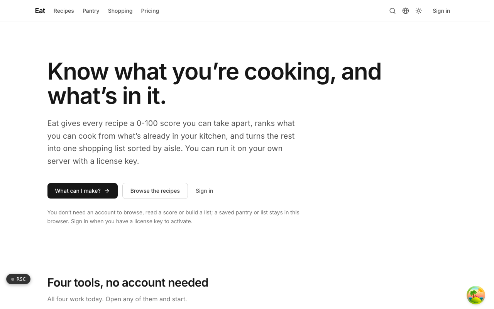
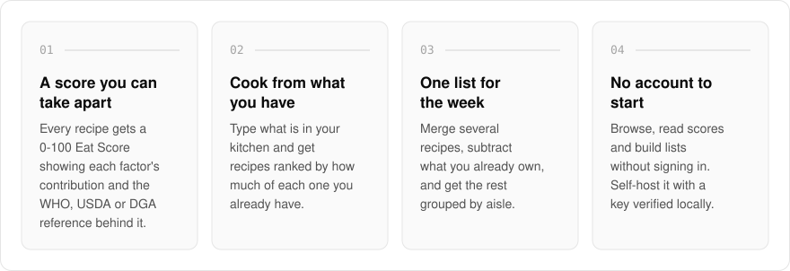
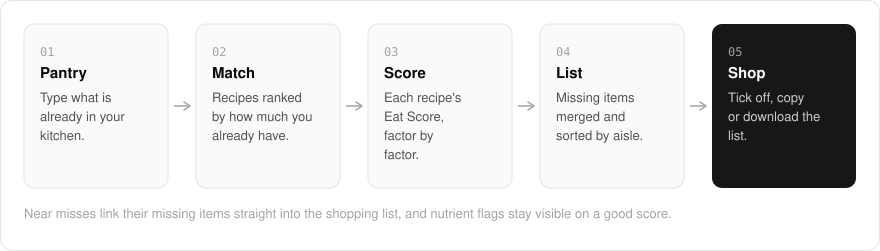
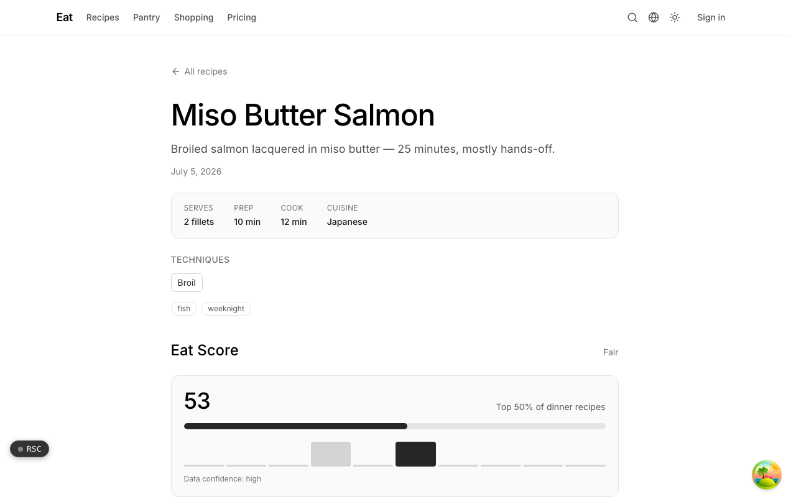
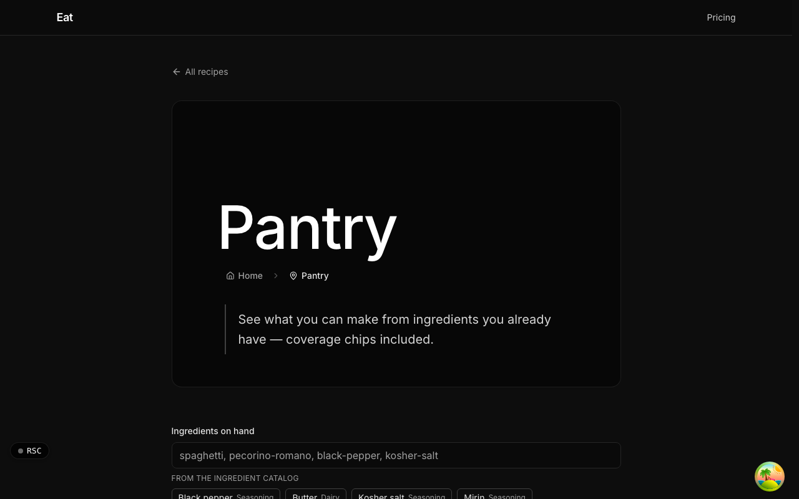
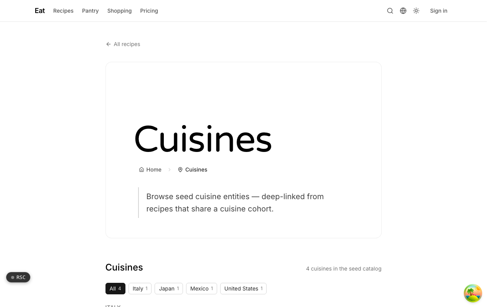
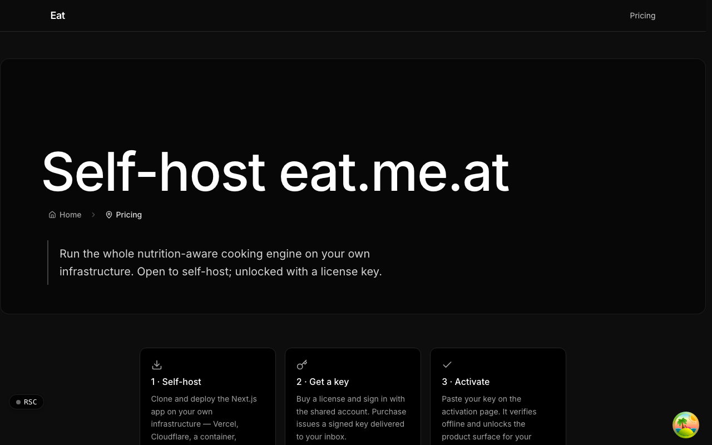

  <picture>
    <source media="(prefers-color-scheme: dark)" srcset=".github/assets/hero-dark.png">
    
  </picture>

<h1 align="center">eat.me.at</h1>

<strong>Know what you're cooking, and what's in it.</strong>

  
  
  
  

  <a href="https://eat.me.at">Website</a> ·
  <a href="#features">Features</a> ·
  <a href="#how-it-works">How it works</a> ·
  <a href="#screenshots">Screenshots</a> ·
  <a href="#built-with">Built with</a>

Most recipe sites call a dish healthy without showing the working, then leave the shopping to you. I built eat.me.at so every recipe carries a 0-100 Eat Score you can take apart factor by factor, ranks what you can cook from what is already in your kitchen, and turns the rest into one shopping list sorted by aisle. Browsing, reading a score and building a list need no account, and you can run the whole thing on your own server with a license key.

  <picture>
    <source media="(prefers-color-scheme: dark)" srcset=".github/assets/overview-dark.svg">
    
  </picture>

## Why eat.me.at

| The usual recipe site | eat.me.at |
| --- | --- |
| A health badge with no working shown | A 0-100 score with each factor's signed contribution and its WHO, USDA or DGA reference |
| A good score hides the problems | Nutrient flags stay visible even when the score is good |
| Recipes you have to shop for | Recipes ranked by what is already in your kitchen |
| One ingredient list per recipe | One list for the week, minus what you own, grouped by aisle |
| Sign up to save anything | A saved pantry or list stays in your browser, with no account |

## Features

- **Eat Score**: every structured recipe gets an explainable 0-100 score showing each factor's signed contribution, the WHO, USDA or DGA reference behind it, a separate data-confidence level, and nutrient flags that stay visible even when the score is good.
- **Cook from what you have**: type what is in your kitchen and get recipes ranked by how much of each you already have, with an avoid list and a coverage threshold. Near misses link their missing items straight into a shopping list.
- **One shopping list for the week**: merge ingredients across several recipes, subtract what you already own, and group the rest by aisle. Filter by allergen, season or substitute, tick items off in the shop, then copy the list or download it as text.
- **Connected recipe pages**: each recipe links to its ingredients, cuisine and techniques, and to dishes with a similar nutrition profile, including healthier alternatives when one exists.
- **Ingredient, cuisine and technique catalogs**: browsable pages with filters, deep-linked from recipes and pantry queries.
- **No account needed to start**: a saved pantry or list stays in your browser. Sign in when you have a license key to activate.
- **Self-hostable**: deploy the Next.js app anywhere Node runs. License keys are verified on your own server against the product's public key, with a grace window if validation lapses.

## How it works

  <picture>
    <source media="(prefers-color-scheme: dark)" srcset=".github/assets/flow-dark.svg">
    
  </picture>

You tell eat what is in your kitchen, and it ranks recipes by how much of each one you already have, honoring your avoid list and coverage threshold. Every recipe shows its Eat Score with the working laid out, so you can see which factors helped and which hurt. Whatever you are missing is merged across recipes into one list grouped by aisle, ready to tick off, copy or download.

## Screenshots

<table>
  <tr>
    <td width="50%"><picture><source media="(prefers-color-scheme: dark)" srcset=".github/assets/recipes--miso-butter-salmon-dark.png"></picture> A recipe page: structured details and the Eat Score breakdown.</td>
    <td width="50%"><picture><source media="(prefers-color-scheme: dark)" srcset=".github/assets/recipes--smash-burgers-dark.png"></picture> A second recipe: the same score breakdown on a different dish.</td>
  </tr>
  <tr>
    <td width="50%"><picture><source media="(prefers-color-scheme: dark)" srcset=".github/assets/pantry-dark.png"></picture> Pantry: recipes ranked by what you already have on hand.</td>
    <td width="50%"><picture><source media="(prefers-color-scheme: dark)" srcset=".github/assets/shopping-dark.png"></picture> Shopping list: ingredients merged across recipes and grouped by aisle.</td>
  </tr>
  <tr>
    <td width="50%"><picture><source media="(prefers-color-scheme: dark)" srcset=".github/assets/cuisines-dark.png"></picture> Cuisines: browse recipes that share a cuisine.</td>
    <td width="50%"><picture><source media="(prefers-color-scheme: dark)" srcset=".github/assets/pricing-dark.png"></picture> Pricing: self-host, get a key, activate.</td>
  </tr>
</table>

## Built with

  
  
  
  
  
  

- Next.js 16 (App Router), React 19, TypeScript
- Tailwind CSS 4
- MDX recipe content collection
- oRPC with TanStack Query
- Drizzle ORM with Postgres
- Better Auth
- next-intl
- Signed license keys with offline verification

## Part of the me.at family

eat.me.at is one of my [`*.me.at`](https://me.at) apps. They share one design system, account, and app shell. Development happens in a private monorepo; this repository is the project's public-facing home.

## License

Source-available. See [LICENSE](LICENSE).
